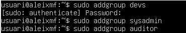
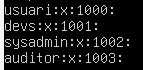
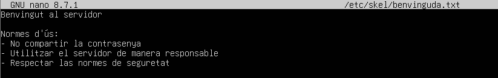
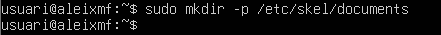
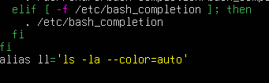

# NF1.UD3.-Usuaris-i-grups

## Tasca 1. Creació de la jerarquia de grups

#### Crea els següents grups nous al sistema:

- devs (per al personal de desenvolupament)
- sysadmin (per al personal de sistemes)
- auditor (per a l'usuari auditor extern)

##### Per crear els grups utilitzarem la seguent comanda:
```bash
sudo addgroup devs
sudo addgroup sysadmin
sudo addgroup auditor
```


##### Tot seguit comprovarem que els grups estan creats posant:
```bash
sudo nano /etc/group
```


## Tasca 2. Gestió dels perfils d'usuari

#### L'empresa vol que tots els usuaris nous que es donin d'alta a partir d'ara tinguin automàticament:

- Un fitxer de benvinguda al seu directori personal amb les normes d'ús del servidor.

```bash
sudo nano /etc/skel/benvinguda.txt
```



- Una carpeta anomenada Documents creada per defecte.

```bash
sudo mkdir -p /etc/skel/documents
```



- Un alias configurat al seu terminal perquè quan escriguin ll s'executi ls -la --color=auto.

Per entrar al ...
```bash
sudo nano /etc/skel/.bashrc
```




